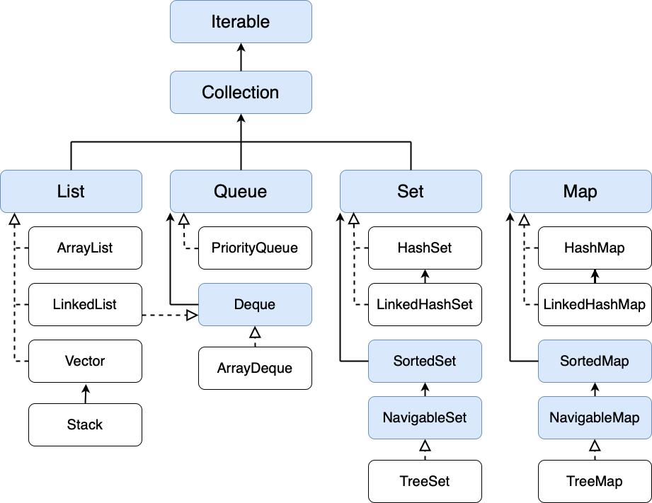

# Java Interview Questions and Answers

A collection of Java interview questions and answers
for beginners and experienced developers.

## Table of Contents

<!-- TOC_START -->
| No. | Questions |
| --- | --------- |
| 1 | [Why is String immutable in Java?](#1-why-is-string-immutable-in-java) |
| 2 | [Is String immutable or final in Java?](#2-is-string-immutable-or-final-in-java) |
| 3 | [What is String Constant Pool (SCP) in Java?](#3-what-is-string-constant-pool-scp-in-java) |
| 4 | [String vs StringBuffer vs StringBuilder](#4-string-vs-stringbuffer-vs-stringbuilder) |
| 5 | [Why do we need Wrapper Classes in Java?](#5-why-do-we-need-wrapper-classes-in-java) |
| 6 | [What is the Object Class?](#6-what-is-the-object-class) |
| 7 | [Object-Oriented Programming (OOPs) Concepts in Java](#7-object-oriented-programming-oops-concepts-in-java) |
| 8 | [Why Java doesn't support multiple inheritance through classes?](#8-why-java-doesnt-support-multiple-inheritance-through-classes) |
| 9 | [Difference Between Abstract Class and Interface](#9-difference-between-abstract-class-and-interface) |
| 10 | [Use of `super` and `this` keyword in Java](#10-use-of-super-and-this-keyword-in-java) |
| 11 | [Java Reflection API](#11-java-reflection-api) |
| 12 | [Throwable, Exception, RuntimeException, and Error](#12-throwable-exception-runtimeexception-and-error) |
| 13 | [`try`, `catch`, and `finally` in Java](#13-try-catch-and-finally-in-java) |
| 14 | [How many ways can we create a thread in Java?](#14-how-many-ways-can-we-create-a-thread-in-java) |
| 15 | [What is the Executor Framework in Java?](#15-what-is-the-executor-framework-in-java) |
| 16 | [What is ExecutorService in Java?](#16-what-is-executorservice-in-java) |
| 17 | [Runnable vs Callable in Java](#17-runnable-vs-callable-in-java) |
| 18 | [What is CompletableFuture in Java?](#18-what-is-completablefuture-in-java) |
| 19 | [What is Virtual Threads (Project Loom) in Java?](#19-what-is-virtual-threads-project-loom-in-java) |
| 20 | [Java Collections Framework](#20-java-collections-framework) |
| 21 | [Important Collections diffs for interviews](#21-important-collections-diffs-for-interviews) |
| 22 | [How does HashMap work internally in Java?](#22-how-does-hashmap-work-internally-in-java) |
| 23 | [How does ConcurrentHashMap work internally in Java?](#23-how-does-concurrenthashmap-work-internally-in-java) |
| 24 | [HashMap vs ConcurrentHashMap](#24-hashmap-vs-concurrenthashmap) |
| 25 | [Explain Stream API in Java](#25-explain-stream-api-in-java) |
| 26 | [Java 8, 17, and 21 Features](#26-java-8-17-and-21-features) |
| 27 | [SOLID Principles](#27-solid-principles) |
<!-- TOC_END -->

# Java Interview Questions

<!-- QUESTIONS_START -->

## Core Java

### 1. Why is String immutable in Java?
String is immutable in Java mainly for security, thread safety, memory optimization, and performance.

- **Security**: Prevents unexpected modification of sensitive data.

- **String Constant Pool**: Allows multiple references to safely share the same String object.

- **Thread Safety**: Multiple threads can share String objects without synchronization.

- **HashCode Caching**: Its hashCode can be cached because its value never changes.

- **Reliability**: Prevents unexpected changes in file paths, URLs, and class-loading-related values.


[⬆ Back to Table](#table-of-contents)

### 2. Is String immutable or final in Java?
- `String` is a final class, so it cannot be subclassed.

- Its internal state is designed to be immutable.

- Making the class final prevents subclasses from overriding its behavior and breaking immutability.

[⬆ Back to Table](#table-of-contents)

### 3. What is String Constant Pool (SCP) in Java?
String Constant Pool is a special memory area inside Java Heap Memory that stores and reuses String literals to reduce duplicate object creation and optimize memory usage.
#### Explanation:

- `String s1 = "Java"`: Creates a String object in the String Constant Pool (if it doesn't already exist).

- `String s2 = "Java"`: Reuses the existing String object from the pool.

- `String s3 = new String("Java")`: Explicitly creates a new String object in Heap Memory outside the pool.

- `s3.intern()` returns the canonical pooled reference for "Java".


| Comparison | Output | Reason |
| ---------- | ------ | ------ |
| `s1 == s2` | true | Both references point to the same object. |
| `s1 == s3` | false | Both references point to different objects. |
| `s1.equals(s3)` | true | Both objects contain the same value. |
| `s1 == s3.intern()` | true | Returns the canonical pooled reference |

[⬆ Back to Table](#table-of-contents)

### 4. String vs StringBuffer vs StringBuilder
| Features | String | StringBuffer | StringBuilder |
|----------|--------|--------------|---------------|
| Mutability | Immutable | Mutable | Mutable |
| Thread Safety | Yes (immutable state) | Yes (synchronized methods) | No |
| Synchronization | Not required | Yes | No |
| Performance | Slow for repeated modifications | Slower than StringBuilder generally | Faster generally |
| Memory | New object for changed value | Modifies existing object | Modifies existing object |
| Introduced | Java 1.0 | Java 1.0 | Java 1.5 |
| Storage | String Pool / Heap | Heap | Heap |


[⬆ Back to Table](#table-of-contents)

### 5. Why do we need Wrapper Classes in Java?
Wrapper classes are needed to convert primitive data types into objects. They are useful when working with Java Collections, supporting autoboxing and unboxing, converting String values into primitives, using utility methods, Generics, and representing null values.

| Reason | Explanation |
|---|---|
| Collections | To store primitive values in collections `ArrayList<Integer>` |
| Generics | Generics support objects, not primitive types |
| Autoboxing | Automatically converts primitive types into wrapper objects `Integer value = 20` |
| Unboxing | Automatically converts wrapper objects into primitive types `int result = value` |
| String Conversion | Converts String values into primitive types `Integer.parseInt("100")` |
| Utility Methods | Provides useful methods and constants `Integer.MAX_VALUE` |
| Null Support | Allows storing null values `Integer value = null` |

#### Object Caching
In Java, Object Caching is an optimization technique where frequently used objects are reused instead of creating new objects every time. Java maintains a cache of Integer objects for values from -128 to 127 by default.
```java
    {
        Integer a = 100;
        Integer b = 100;

        System.out.println(a == b); // true

        Integer x = 200;
        Integer y = 200;

        System.out.println(x == y); // false
        System.out.println(a.equals(b)); // true
    }
```

[⬆ Back to Table](#table-of-contents)

### 6. What is the Object Class?
In Java, the Object class is the root class of the Java class hierarchy.
- Every class in Java directly or indirectly inherits from the Object class.
- If a class does not explicitly extend another class, it implicitly extends Object.
- The Object class belongs to the java.lang package.
- It provides common methods that can be used by every Java object.

#### Object Class Methods
| Method | Description |
|---|---|
| `toString()` | Returns the string representation of an object. |
| `equals(Object obj)` | Compares two objects for logical equality. |
| `hashCode()` | Returns the hash code of an object. |
| `getClass()` | Returns the runtime class of an object. |
| `clone()` | Creates and returns a copy of an object. |
| `finalize()` | Deprecated method previously used during garbage collection. |
| `wait()` | Causes the current thread to wait. |
| `wait(long timeout)` | Causes the current thread to wait for a specified time. |
| `wait(long timeout, int nanos)` | Causes the current thread to wait for a specified time in milliseconds and nanoseconds. |
| `notify()` | Wakes up one waiting thread. |
| `notifyAll()` | Wakes up all waiting threads. |

Note: finalize() has been deprecated since Java 9 and deprecated for removal since Java 18. It should not be used in modern Java applications.


[⬆ Back to Table](#table-of-contents)

### 7. Object-Oriented Programming (OOPs) Concepts in Java
It is a programming approach in which software is designed using objects and classes.
An object contains:

- __State__: Data or properties (variables).
- __Behavior__: Actions or functionality (methods).
- __Identity__: A unique identity that distinguishes one object from another.

There are four major pillars of OOPs:
#### 1. Encapsulation
Encapsulation is the process of wrapping data (variables) and methods into a single unit (class) and restricting direct access to the data.
- Encapsulation is also known as data hiding, although data hiding is only one aspect of encapsulation.
- It protects data from unauthorized direct access.
- It provides controlled access through methods.
- It improves maintainability and flexibility.

In Java, encapsulation is achieved using:

- Private variables.
- Public getter and setter methods.

#### 2. Inheritance
Inheritance is a mechanism in which one class acquires the properties and behaviors of another class. It promotes code reusability.
- Java supports single, multilevel, and hierarchical inheritance through classes.
- Java does not support multiple inheritance through classes.
- Java supports multiple inheritance through interfaces.
- Constructors are not inherited.
- The `super` keyword is used to access parent-class members and constructors.
- Private members are not directly accessible in subclasses.
- A final class cannot be extended.

#### Terminology
- __Parent Class__: Superclass or Base Class.
- __Child Class__: Subclass or Derived Class.
- `extends`: Keyword used to inherit a class.

#### 3. Polymorphism
Polymorphism means **one name, many forms**. It allows the same method or interface to behave differently depending on the context.

#### i. Compile-Time Polymorphism (Method Overloading)
When multiple methods have the same name but different parameter lists within a class, it is called method overloading.
- Method names must be the same.
- Parameter lists must be different.
- Return type alone cannot distinguish overloaded methods.
- It is resolved at compile time.
- Static methods can also be overloaded.

#### ii. Runtime Polymorphism (Method Overriding)
When a child class provides its own implementation of a method already defined in its parent class, it is called method overriding.
- Method names and parameter lists must match.
- The child class provides a different implementation.
- It requires inheritance or an applicable interface implementation relationship.
- It is resolved at runtime through dynamic method dispatch.
- Static methods are hidden, not overridden.
- Private methods cannot be overridden.
- Final methods cannot be overridden.

#### 4. Abstraction
Abstraction is the process of hiding implementation details and showing only essential functionality to the user.<br>
In Java, abstraction can be achieved using:

#### i. Abstract Class
An abstract class is a class declared using the abstract keyword.<br>
It can contain:
- Abstract methods.
- Concrete methods.
- Constructors.
- Instance variables.
- Static methods.
An abstract class cannot be instantiated directly.

#### ii. Interface
An interface is a reference type that defines a contract that implementing classes agree to follow.
It is declared using the interface keyword.<br>
Interfaces can contain:
- Abstract methods.
- Default methods.
- Static methods.
- Private methods (Java 9 onwards).
- Constants.

[⬆ Back to Table](#table-of-contents)

### 8. Why Java doesn't support multiple inheritance through classes?
Java does not support multiple inheritance through classes because it can create ambiguity, such as the diamond problem, where two parent classes provide the same method implementation.
- Class B inherits from Class A.
- Class C inherits from Class A.
- Class D inherits from both B and C.

If B and C provide different implementations of the same method, which implementation should D use?<br>
This ambiguity is called the Diamond Problem. However, Java supports multiple inheritance of type through interfaces.

[⬆ Back to Table](#table-of-contents)

### 9. Difference Between Abstract Class and Interface
| Abstract Class | Interface |
|---|---|
| Declared using `abstract class` | Declared using `interface` |
| Can have constructors | Cannot have constructors |
| Can have instance variables | Fields are `public`, `static`, and `final` |
| Can contain abstract and concrete methods | Can contain abstract, default, static, and private methods |
| A class can extend only one class | A class can implement multiple interfaces |
| Supports shared state and implementation | Primarily defines a contract |
| Uses `extends` | Uses `implements` |

#### Use Abstract Class When:

- Classes share common state.
- Classes require common implementation.
- You want to provide a base class with constructors.

#### Use Interface When:

- You want to define a contract.
- Unrelated classes should provide common functionality.
- You need multiple inheritance of type.

[⬆ Back to Table](#table-of-contents)

### 10. Use of `super` and `this` keyword in Java
In Java, `super` and `this` are keywords used to refer to the current object and its parent class. They are commonly used in inheritance and constructors.

__i. `this` keyword__: The `this` keyword refers to the current class object.
- To refer to current class instance variables `this.id`.
- To call current class methods `this.value()`.
- To call the current class constructor using `this()`.
- To pass the current object as an argument `value(this)`.

__ii. `super` keyword__: The super keyword refers to the immediate parent class object.
- To access parent class variables `super.id`.
- To call parent class methods `super.value()`.
- To call parent class constructor using `super()`.

#### Important interview points:

- `this()` and `super()` must be the first statement in a constructor.
- You cannot use both `this()` and `super()` in the same constructor.
- Java automatically inserts `super()` if no explicit constructor call is written (provided the parent has an accessible no-argument constructor).


[⬆ Back to Table](#table-of-contents)

### 11. Java Reflection API
The Java Reflection API allows a Java program to inspect and manipulate classes, methods, constructors, fields, and interfaces at runtime.

Reflection is useful when you want to:
- Get class information at runtime.
- Access private variables and methods.
- Create objects dynamically.
- Call methods dynamically.
- Read or modify fields.
- Inspect constructors and interfaces.

#### Real-world Uses of Reflection
- **Spring Framework**: Dependency injection and bean creation.
- **Hibernate**: Entity inspection and object mapping.
- **JUnit**: Discovering and executing test methods.
- **Jackson**: Mapping Java objects to JSON.
- **Maven/Plugins**: Dynamic class loading and plugin execution.

[⬆ Back to Table](#table-of-contents)

## Exception Handling

### 12. Throwable, Exception, RuntimeException, and Error
#### __i. Throwable__
`Throwable` is the parent class of all errors and exceptions in Java.<br>
It has two main child classes:
- Exception
- Error
```
Object
   |
Throwable
   |----------|
Exception    Error
   |
RuntimeException
```
#### __ii. Exception__
`Exception` represents conditions that an application may want to handle. There are two main categories:<br>
__a. Checked Exception__<br>
- Checked at compile time. The programmer must handle it using `try-catch` or declare it using `throws`.
- Examples: `IOException`, `SQLException`, `ClassNotFoundException`
```java
try {
        FileReader f = new FileReader("abc.txt");
    } catch (IOException e) {
        System.out.println("File not found");
    }
```
__b. Unchecked Exception__<br>
These are exceptions under `RuntimeException`. The compiler does not require you to handle them.

#### __iii. RuntimeException__
- `RuntimeException` is a child class of `Exception`.
- It represents exceptions that generally occur during program execution.
- Examples: `ArithmeticException`, `NullPointerException`, `NumberFormatException`, `ClassCastException`
```java    
    int a = 10;
    int b = 0;

    System.out.println(a / b); // ArithmeticException
```

#### __iv. RuntimeException__<br>
- Error represents serious problems that applications generally cannot recover from.
- Examples: `OutOfMemoryError`, `StackOverflowError`, `VirtualMachineError`, `AssertionError`


[⬆ Back to Table](#table-of-contents)

### 13. `try`, `catch`, and `finally` in Java

#### __i. `try` block__
- Contains code that might cause an exception.
- Java monitors this code for errors.
- If an exception occurs, control moves to the matching `catch` block.

#### __ii. `catch` block__
- Handles the exception thrown by the `try` block.
- You can have multiple catch blocks to handle different types of exceptions.

#### __iii. finally block__
- Executes whether an exception occurs or not (with a few exceptional termination cases).
- Commonly used for cleanup operations, such as closing files or database connections.

#### Important rules for interviews
- A `try` block must be followed by at least one `catch` or a `finally` block.
- You can use multiple `catch` blocks.
- Only one matching `catch` block executes.
- `finally` generally executes whether an exception occurs or not.
- `finally` is commonly used to release resources.
- A `finally` block may not execute if the JVM terminates abruptly, such as through `System.exit()`.

#### **W.r.t. `return` statement**
**i. Return inside try block**<br> 
If the `try` block has a return statement, the `finally` block executes before the method actually returns.

```java
public class Main {
    static int test() {
        try {
            return 10;
        }
        finally {
            System.out.println("Finally executed");
        }
    }

    public static void main(String[] args) {
        System.out.println(test());
    }
}
```

Output:
```
Finally executed
10
```

**ii. Return inside both try and finally**<br>
If both blocks contain return statements, the `finally` return overrides the `try` return.
```java
public class Main {
    static int test() {
        try {
            return 10;
        }
        finally {
            return 20;
        }
    }

    public static void main(String[] args) {
        System.out.println(test());
    }
}
```
Output:
```
20
```
**iii. Return inside catch and finally**
```java
public class Main {
    static int test() {
        try {
            int x = 10 / 0;
            return 10;
        }
        catch (Exception e) {
            return 20;
        }
        finally {
            return 30;
        }
    }

    public static void main(String[] args) {
        System.out.println(test());
    }
}
```
Output:
```
30
```
**iv. Return inside try, but finally modifies the variable**
```java
public class Main {
    static int test() {
        int a = 10;

        try {
            return a;
        }
        finally {
            a = 20;
        }
    }

    public static void main(String[] args) {
        System.out.println(test());
    }
}
```
When Java encounters `return a`, it saves the return value (10). Then the `finally` block changes a to 20, but the saved return value remains 10.

Output:
```
10
```
**v. Return with an object reference**
```java
public class Main {
    static int[] test() {
        int[] arr = {10};

        try {
            return arr;
        }
        finally {
            arr[0] = 20;
        }
    }

    public static void main(String[] args) {
        System.out.println(test()[0]);
    }
}
```
The return value is a reference to the array. The `finally` block modifies the same array object before the method returns.

Output:
```
20
```

[⬆ Back to Table](#table-of-contents)

## Multithreading

### 14. How many ways can we create a thread in Java?
There are two basic ways:
#### **i. Extending the Thread class**
- `Thread` is the predefined Java class.
- `run()` contains the task to execute.
- `start()` starts a new thread and invokes `run()`.
- `run()` executes like a normal method when called directly.
```java
class MyThread extends Thread {

    public void run() {
        System.out.println("Thread is running");
    }

    public static void main(String[] args) {

        MyThread t1 = new MyThread();

        t1.start();
    }
}
```
#### **i. Implementing the Runnable interface**
- Create a class that implements `Runnable` and override its `run()` method.
- Since `Runnable` is a functional interface, we can use a `lambda` expression.

Note: Implementing `Runnable` is generally preferred because Java supports single inheritance, allowing your class to extend another class.
```java
class MyThread implements Runnable {

    public void run() {
        System.out.println("Thread is running");
    }

    public static void main(String[] args) {

        MyThread obj = new MyThread();

        Thread t1 = new Thread(obj);

        t1.start();
    }
}
```

#### Life Cycle of a Thread
A Java thread has six states:
| **State** | **Meaning** |
| ----- | ----- |
| NEW | Thread is created |
| RUNNABLE | Thread is ready or running |
| BLOCKED | Waiting to acquire a monitor lock |
| WAITING | Waiting indefinitely for another thread |
| TIMED_WAITING | Waiting for a specified time |
| TERMINATED | Thread execution is completed |


[⬆ Back to Table](#table-of-contents)

### 15. What is the Executor Framework in Java?
The Executor Framework is a part of the java.util.concurrent package introduced in Java 5.
It provides a higher-level API to manage thread creation, thread execution, and thread lifecycle.
Instead of manually creating threads, we submit tasks to an Executor, which manages their execution.

```
Executor
   |
   v
ExecutorService
   |
   v
ScheduledExecutorService
```

**Benefits**:

- Thread reusability.
- Better resource management.
- Asynchronous task execution.
- Improved application scalability.
- Separation of task submission from task execution.


[⬆ Back to Table](#table-of-contents)

### 16. What is ExecutorService in Java?
`ExecutorService` is an interface extends `Executor` in Java's `java.util.concurrent` package used to manage and execute asynchronous tasks using a pool of threads.

Instead of manually creating and managing threads, ExecutorService handles thread creation, task execution, and thread lifecycle management.

**Types of ExecutorService**
| Type | Description |
|---|---|
| `newFixedThreadPool(5)` | Creates a pool with 5 fixed threads |
| `newCachedThreadPool()` | Creates threads as needed and reuses idle threads |
| `newSingleThreadExecutor()` | Executes tasks sequentially using one thread |
| `newScheduledThreadPool(3)` | Executes tasks after a delay or periodically |

**Important methods**
| Method | Purpose |
|---|---|
| `execute()` | Executes a `Runnable` task |
| `submit()` | Submits a task and returns a `Future` |
| `shutdown()` | Stops accepting new tasks |
| `shutdownNow()` | Attempts to stop running tasks |
| `isShutdown()` | Checks whether shutdown was initiated |
| `isTerminated()` | Checks whether all tasks have completed |
| `awaitTermination()` | Waits for task completion |


[⬆ Back to Table](#table-of-contents)

### 17. Runnable vs Callable in Java
Both `Runnable` and `Callable` are functional interfaces in Java used to represent tasks that can be executed by threads or the Executor Framework.

The main difference is that `Runnable` cannot return a result or throw checked exceptions, whereas `Callable` can do both.

| Feature | Runnable | Callable |
|---|---|---|
| **Package** | `java.lang` | `java.util.concurrent` |
| **Method** | `run()` | `call()` |
| **Return type** | `void` | Generic type `V` |
| **Returns a result** | No | Yes |
| **Checked exceptions** | Cannot declare checked exceptions | Can throw checked exceptions |
| **Used with** | `Thread`, `ExecutorService` | `ExecutorService` |
| **Result retrieval** | Not directly supported | Through `Future` |

[⬆ Back to Table](#table-of-contents)

### 18. What is CompletableFuture in Java?
`CompletableFuture` is a Java class used for asynchronous and non-blocking programming. It allows you to execute tasks in the background, perform operations after tasks complete, combine multiple asynchronous tasks, and handle exceptions.

| Method | Description | Return Type |
|---|---|---|
| `supplyAsync()` | Executes an asynchronous task and returns a result. | `CompletableFuture<T>` |
| `runAsync()` | Executes an asynchronous task without returning a result. | `CompletableFuture<Void>` |
| `thenApply()` | Transforms the result of the previous task. | `CompletableFuture<U>` |
| `thenApplyAsync()` | Transforms the result asynchronously using an executor. | `CompletableFuture<U>` |
| `thenAccept()` | Consumes the result without returning anything. | `CompletableFuture<Void>` |
| `thenCompose()` | Chains dependent asynchronous tasks and avoids nested `CompletableFuture`. | `CompletableFuture<U>` |
| `thenCombine()` | Combines results of two independent `CompletableFuture` tasks. | `CompletableFuture<V>` |
| `allOf()` | Waits for all supplied `CompletableFuture` tasks to complete. | `CompletableFuture<Void>` |
| `anyOf()` | Completes when any one of the supplied futures completes. | `CompletableFuture<Object>` |
| `exceptionally()` | Handles exceptions and provides a fallback result. | `CompletableFuture<T>` |
| `handle()` | Handles both successful and exceptional completion. | `CompletableFuture<U>` |
| `whenComplete()` | Executes an action after completion without changing the result. | `CompletableFuture<T>` |
| `thenRun()` | Executes an action after the previous task without receiving its result. | `CompletableFuture<Void>` |
| `get()` | Retrieves the result and blocks until completion; throws checked exceptions. | `T` |
| `join()` | Retrieves the result and blocks until completion; throws unchecked exceptions. | `T` |
| `getNow()` | Returns the result if completed; otherwise returns a default value. | `T` |
| `orTimeout()` | Completes exceptionally if the specified timeout expires. | `CompletableFuture<T>` |
| `completeOnTimeout()` | Completes with a fallback value if the specified timeout expires. | `CompletableFuture<T>` |
| `complete()` | Manually completes the future with a given value. | `boolean` |
| `completeExceptionally()` | Manually completes the future exceptionally. | `boolean` |
| `cancel()` | Attempts to cancel the future. | `boolean` |
| `isDone()` | Checks whether the future has completed. | `boolean` |


[⬆ Back to Table](#table-of-contents)

### 19. What is Virtual Threads (Project Loom) in Java?
**Virtual Threads** are lightweight threads introduced in **Java 21** as a permanent feature (Project Loom). They make it easier to build highly concurrent applications without creating thousands of expensive platform (OS) threads.

Virtual Threads can be created by using:
- `Thread.startVirtualThread()`
- `Thread.ofVirtual()`
- `Executors.newVirtualThreadPerTaskExecutor()`

#### i. How Virtual Threads Work internally
Virtual threads run on top of platform threads called Carrier Threads. This allows a small number of platform threads to support a large number of virtual threads.

The execution works like this:

- JVM creates a virtual thread.
- JVM schedules it onto a carrier platform thread.
- The virtual thread executes its task.
- When it performs a supported blocking operation, it can unmount from the carrier thread.
- The carrier thread becomes available to execute another virtual thread.
- When the blocked operation completes, the virtual thread can be scheduled again.

#### ii. Good use cases:

- REST API calls
- Database calls
- Microservices
- HTTP client requests
- File I/O
- Applications handling thousands of concurrent requests

#### iii. Not particularly useful for:

- CPU-intensive calculations
- Image processing
- Heavy mathematical operations
- Tasks that continuously consume CPU

#### iv. Virtual Thread Limitations
- Don't pool virtual threads. Generally, create one per task.
- Don't use virtual threads to increase CPU parallelism.
- Avoid excessive synchronization that can cause thread pinning.
- Be careful with database connection pools: virtual threads don't increase the number of available database connections.
- Virtual threads are daemon threads, so they don't keep the JVM alive by themselves.

#### Platform Thread vs Virtual Thread

| Feature | Platform Thread | Virtual Thread |
|---|---|---|
| Introduced | Java 1.0 | Java 21 (permanent) |
| Managed by | OS scheduler | JVM scheduler |
| OS mapping | 1:1 | Many:1 |
| Creation cost | Relatively high | Very low |
| Memory consumption | Higher | Lower |
| Context switching | OS-managed | JVM scheduling plus OS scheduling |
| Blocking I/O | Usually blocks OS thread | Usually releases carrier thread |
| Scalability | Comparatively limited | Very high |
| CPU-intensive tasks | Suitable | No special advantage |
| I/O-intensive tasks | Less efficient at high concurrency | Very suitable |

[⬆ Back to Table](#table-of-contents)

## Collections

### 20. Java Collections Framework
The Java Collections Framework (JCF) is a set of classes and interfaces in Java used to store, manage, and manipulate groups of objects efficiently.<br>
The framework is mainly divided into these interfaces:
- List
- Set
- Queue
- Map

Note: Map is part of the Collections Framework, but it does not extend the Collection interface.


#### **List Interface**
- Maintains insertion order.
- Allows duplicate elements.
- Allows null elements in common implementations.
- Supports index-based access.
- Elements can be inserted or removed at specific positions.

1. **ArrayList**
- ArrayList uses a dynamic array internally.
- Fast searching using indexes.
- Insertion in the middle can be slower.
- **Use**: When you frequently retrieve elements using their indexes.
2. **LinkedList**
- LinkedList stores elements as nodes connected through links.
- Implements List and Deque.
- Efficient insertion and deletion when the position is known.
- Java's LinkedList is a doubly linked list.
- **Use**: When you need frequent insertion and deletion at the ends, or queue/deque operations.
3. **Vector**
- Vector is a dynamic array similar to ArrayList.
- Vector's methods are synchronized.
- Legacy collection class.
4. **Stack**
- Stack is a legacy class that extends Vector.
- It follows the LIFO (Last In, First Out) principle.

#### **Set Interface**
- Does not allow duplicate elements.
- Does not support index-based access.
- Ordering depends on the implementation.
- Usually allows at most one null in implementations that support null.

#### **SortedSet Interface**
- SortedSet stores elements in sorted order.
- It is an interface, not a class.
- Its common implementation is TreeSet.

#### **NavigableSet Interface**
- NavigableSet extends SortedSet.
- It provides additional navigation methods.

1. **HashSet** 
- HashSet stores unique elements using a hash table.
- Does not guarantee insertion order.
- **Use**: When you want to store unique elements and do not need ordering.
2. **LinkedHashSet** 
- LinkedHashSet stores unique elements and maintains insertion order.
- **Use**: When you need unique elements in insertion order.
3. **TreeSet** 
- TreeSet implements NavigableSet.
- Stores elements in sorted order.

#### **Queue Interface**
- Queue is used to store elements for processing.
- Generally follows FIFO (First In, First Out).
- Used in scheduling and processing tasks.

#### **Deque Interface**
- Deque means Double Ended Queue.
- It allows insertion and deletion from both ends.

1. **PriorityQueue**
- PriorityQueue processes elements based on priority rather than insertion order.
- By default, numbers are processed in natural ascending order.
- **Use**: Task scheduling, priority-based processing, and selecting the smallest or largest element.
2. **ArrayDeque**
- ArrayDeque is a resizable array implementation of the Deque interface.
- It allows insertion and deletion from both ends.
- ArrayDeque does not allow null elements.

**LinkedList**: Can also be used as a queue.

#### **Map Interface**
- Stores data in key-value pairs.
- Keys must be unique.
- Values can be duplicated.
- Each key maps to at most one value.
- Does not extend the Collection interface.

#### **SortedMap Interface**
SortedMap stores keys in sorted order.

#### **NavigableMap Interface**
- NavigableMap extends SortedMap.
- It provides methods to navigate through keys.

1. **HashMap**
- HashMap stores key-value pairs using hashing.
- It does not guarantee insertion order.
2. **LinkedHashMap**
- LinkedHashMap maintains insertion order by default.
- **Use**: When you need key-value pairs in insertion order.
3. **TreeMap**
- TreeMap implements NavigableMap.
- It stores entries sorted according to keys.
4. **Hashtable**<br>
Legacy synchronized map.


[⬆ Back to Table](#table-of-contents)

### 21. Important Collections diffs for interviews


#### **1. ArrayList vs LinkedList in Java**
| Basis | ArrayList | LinkedList |
|---|---|---|
| Internal Structure | Dynamic Array | Doubly Linked List |
| Memory Usage | Less memory | More memory |
| Accessing Elements | Fast - O(1) | Slow - O(n) |
| Searching | O(n) | O(n) |
| Insertion at Beginning | O(n) | O(1) |
| Insertion at End | O(1) Amortized | O(1) |
| Insertion/Deletion in Middle | O(n) | O(n)* |
| Performance | Better for accessing elements | Useful for frequent operations at ends |
| Interfaces | List, RandomAccess | List, Deque |
| Best Use Case | Frequent searching and retrieval | Frequent insertion and deletion at ends |

**Note:** In LinkedList, middle insertion/deletion takes O(1) after reaching the required position, but finding that position takes O(n).

#### Interview Tips
- **ArrayList:** Best for fast searching and index-based access.
- **LinkedList:** Best for frequent insertion and deletion at both ends.
- **ArrayList** is generally preferred in real-world Java applications.
- Both allows duplicate and null elements.

#### **2. HashSet vs TreeSet in Java**

| Basis | HashSet | TreeSet |
|---|---|---|
| Internal Structure | Hash Table | Red-Black Tree |
| Ordering | No guaranteed order | Sorted order (Ascending by default) |
| Duplicate Elements | Not Allowed | Not Allowed |
| Null Values | Allows one null | Generally does not allow null |
| Insertion | O(1) Average | O(log n) |
| Deletion | O(1) Average | O(log n) |
| Searching | O(1) Average | O(log n) |
| Performance | Faster | Slower than HashSet generally |
| Interfaces | Set | NavigableSet, SortedSet |
| Best Use Case | Fast insertion, deletion and searching | Maintaining sorted and unique elements |

#### Interview Tips
- **HashSet:** Use when you need unique elements with faster operations.
- **TreeSet:** Use when you need unique elements in sorted order.
- Both do not allow duplicate elements.
- HashSet uses `hashCode()` and `equals()` to identify duplicates.
- TreeSet uses `Comparable` or `Comparator` to sort elements and identify equivalent elements.

#### **3. HashMap vs Hashtable in Java**

| Basis | HashMap | Hashtable |
|---|---|---|
| Internal Structure | Hash Table | Hash Table |
| Thread Safety | Not Synchronized | Synchronized |
| Performance | Faster | Slower |
| Null Keys | Allows one null key | Does not allow null keys |
| Null Values | Allows multiple null values | Does not allow null values |
| Insertion | O(1) Average | O(1) Average |
| Searching | O(1) Average | O(1) Average |
| Ordering | No guaranteed order | No guaranteed order |
| Introduced In | Java 1.2 | Java 1.0 |
| Best Use Case | Non-threaded applications | Legacy synchronized applications |

#### Interview Tips
- **HashMap:** Use when thread safety is not required. It provides better performance.
- **Hashtable:** Synchronized and thread-safe, but generally slower.
- HashMap allows one null key and multiple null values.
- Hashtable does not allow null keys or null values.
- Both store data in key-value pairs and do not allow duplicate keys.
- For modern concurrent applications, prefer `ConcurrentHashMap` over Hashtable.

[⬆ Back to Table](#table-of-contents)

### 22. How does HashMap work internally in Java?
- HashMap is a part of the Java Collection Framework that stores data in key-value pairs.
- Internally, it uses an array of buckets. Each bucket can contain a linked list of nodes, and from Java 8 onwards, if collisions increase beyond a certain threshold, the linked list can be converted into a Red-Black Tree.
- HashMap uses the key's hashCode() method to calculate the bucket location and equals() to identify the correct key.

#### **Internal structure**
Internally, HashMap maintains an array of Node objects. Each Node contains four things: hash, key, value, and next reference.
```java
static class Node<K,V> {
    final int hash;
    final K key;
    V value;
    Node<K,V> next;
}
```
- Hash stores the calculated hash value.
- Key stores the actual key.
- Value stores the corresponding value.
- Next points to the next node when multiple entries belong to the same bucket.

#### **Map.put(k, v)**
- Whenever we call put(), HashMap first calculates the hashCode() of the key.
- Then it applies a hash-spreading function to improve distribution.
- After that, it calculates the bucket index using the formula (n - 1) & hash, where n is the array capacity.
- If the bucket is empty, it inserts a new node.
- If the bucket already contains an entry, HashMap checks whether the key already exists using hash comparison and equals().
- If the key exists, it updates the value. Otherwise, it adds a new node to that bucket.
```java
static final int hash(Object key) {
    int h;
    return (key == null) ? 0 : (h = key.hashCode()) ^ (h >>> 16);
}
```

#### **Hash Collision**
- When two keys have the same bucket index, this situation is called a collision.
- HashMap handles collisions using separate chaining.
- Multiple nodes can be stored in the same bucket using a linked list.
- From Java 8 onwards, if the bucket becomes sufficiently crowded and the table capacity is at least 64, HashMap can convert the linked list into a Red-Black Tree to improve search performance.

#### **Map.get(k)**
- When we call get(key), HashMap calculates the hash of the key and identifies the bucket index.
- Then it checks the first node.
- If the hash matches and the key matches using equals(), it returns the value.
- Otherwise, it traverses the linked list or searches the tree until it finds the matching key.

#### **Resizing**
- By default, HashMap has an initial capacity of 16 and a load factor of 0.75.
- Therefore, its initial threshold is 16 multiplied by 0.75, which is 12.
- When the number of entries exceeds the threshold, HashMap increases its capacity, generally doubling it from 16 to 32.
- This helps maintain efficient performance.

#### **Contract - equals() and hashCode()**
- HashMap uses hashCode() to identify the bucket and equals() to identify the actual key.
- If two objects are logically equal, they must return the same hashCode().
- If we override equals() without correctly overriding hashCode(), HashMap may not be able to retrieve logically equal objects correctly.

#### **Treeification in Java 8+**
When a bucket becomes sufficiently crowded, HashMap can convert its linked list into a Red-Black Tree.

Important internal constants:

| Constant | Value |
| ---- | ---- |
| TREEIFY_THRESHOLD	| 8 |
| UNTREEIFY_THRESHOLD |	6 |
| MIN_TREEIFY_CAPACITY | 64 |

Important points:

- Treeification is considered when a bucket reaches the treeification threshold.
- If the table capacity is less than 64, HashMap prefers resizing instead of treeification.
- A tree bin can be converted back into a linked list when it becomes sufficiently small.
#### Why Red-Black Tree?

- Linked List search: O(n).
- Red-Black Tree search: O(log n), under suitable key ordering.


[⬆ Back to Table](#table-of-contents)

### 23. How does ConcurrentHashMap work internally in Java?
- `ConcurrentHashMap` is a thread-safe implementation of the Map interface in Java.
- It allows multiple threads to read and update the map concurrently without locking the entire map.
- Unlike HashMap, it is designed for multithreaded environments.
- Does not allow null keys or null values.

Internally, ConcurrentHashMap uses:

- An array of buckets (table).
- Linked lists to handle hash collisions.
- Red-Black Trees when a bucket contains too many nodes.
- CAS operations for lock-free updates in certain situations.
- Synchronized blocks for bucket-level locking.

#### **1. Map.put(k, v)**
ConcurrentHashMap does not lock the entire map during insertion. It uses fine-grained synchronization at the bucket level.
- Calculate the hash of the key.
- Find the bucket index using the hash.
- Check whether the bucket is empty.
- If the bucket is empty, use CAS (Compare-And-Swap) to insert the new node.
- If the bucket already contains nodes, synchronize on the first node in that bucket.
- Traverse the linked list to check whether the key already exists.
- If the key exists, update its value.
- Otherwise, add a new node.
- If the number of nodes in a bucket reaches the treeification threshold, it may convert the linked list into a Red-Black Tree.

#### **2. Map.get(k)**
Read operations generally do not require locking.
- Calculate the hash of the key.
- Find the corresponding bucket.
- Check the first node.
- If the key matches, return the value.
- Otherwise, traverse the linked list or search the Red-Black Tree.
- Return the matching value.

**CAS (Compare-And-Swap)**

- CAS is an atomic operation.
- It checks whether a memory location contains an expected value. If it does, it updates that value atomically.
- For example, when two threads try to insert elements into the same empty bucket, CAS ensures that only one thread successfully inserts its node. The other thread retries.

**Synchronized block**

- When a bucket is already occupied, ConcurrentHashMap synchronizes on the first node of that bucket before modifying its contents.
- This means different buckets can be modified concurrently by different threads.


[⬆ Back to Table](#table-of-contents)

### 24. HashMap vs ConcurrentHashMap

| Feature | HashMap | ConcurrentHashMap |
|---|---|---|
| Thread Safety | Not thread-safe | Thread-safe |
| Synchronization | No synchronization | CAS + synchronized |
| Null Keys | One allowed | Not allowed |
| Null Values | Multiple allowed | Not allowed |
| Performance | Faster in single-threaded scenarios | Better for concurrent access |
| Locking | No locking | Fine-grained locking |
| Concurrent Access | Not safe for concurrent modifications | Supports concurrent operations |
| Iterator | Fail-fast | Weakly consistent |
| Internal Structure | Array + LinkedList + Red-Black Tree | Array + LinkedList + Red-Black Tree |

[⬆ Back to Table](#table-of-contents)

### 25. Explain Stream API in Java
- The Stream API in Java (introduced in Java 8) is used to process collections of data in a functional and declarative way.
- It allows you to perform operations such as filtering, sorting, mapping, and reducing data without writing lengthy loops.
- A Stream is a sequence of elements that supports operations to process data.
#### Intermediate operations
- Intermediate operations are the operations in Java Stream API that transform or filter the elements of a Stream. 
- They return another Stream, so we can chain multiple intermediate operations together.
- They are lazy in nature, which means they are not executed until a terminal operation is called.
- `filter()`, `map()`, `sorted()`
#### Terminal Operations
- Terminal operations are the operations that produce the final result or perform an action on the Stream. 
- They trigger the execution of the Stream pipeline and consume the Stream. 
- After a terminal operation, we cannot reuse the same Stream.
- `forEach()`, `collect()`, `toList()`

[⬆ Back to Table](#table-of-contents)

### 26. Java 8, 17, and 21 Features

#### **1. Java 8 Features**

| Feature | Description |
|---|---|
| Lambda Expressions | Allows writing concise functional code |
| Functional Interfaces | Interface containing exactly one abstract method |
| Stream API | Processes collections using functional operations |
| Default Methods | Allows interfaces to have method implementations |
| Static Methods in Interfaces | Allows static methods inside interfaces |
| Method References | Refers to methods using the `::` operator |
| Optional Class | Helps avoid NullPointerException |
| New Date and Time API | Introduced LocalDate, LocalTime, LocalDateTime |
| CompletableFuture | Supports asynchronous programming |
| forEach() | Iterates over collections using lambda expressions |

#### **2. Java 17 Features**

| Feature | Description |
|---|---|
| Sealed Classes | Restricts which classes can extend or implement a class/interface |
| Pattern Matching for instanceof | Eliminates explicit type casting |
| Records | Simplifies immutable data carrier classes |
| Text Blocks | Supports multiline strings |
| Switch Expressions | Allows switch to return values |
| Strong Encapsulation | Strongly encapsulates JDK internals |
| Random Generator API | Provides improved random number generation |
| Enhanced Pseudo-Random Number Generators | Introduces new random generator algorithms |

**Note:** Records, Text Blocks, and Switch Expressions were finalized in earlier Java versions but are available in Java 17.

#### **3. Java 21 Features**

| Feature | Description |
|---|---|
| Virtual Threads | Lightweight threads for handling large numbers of concurrent tasks |
| Record Patterns | Allows destructuring record values |
| Pattern Matching for switch | Supports pattern matching inside switch expressions |
| Sequenced Collections | Introduces APIs for collections with defined encounter order |
| String Templates | Preview feature for string interpolation |
| Unnamed Patterns and Variables | Allows unused variables to be represented using `_` (Preview) |
| Unnamed Classes and Instance Main Methods | Simplifies writing basic Java programs (Preview) |
| Scoped Values | Provides a mechanism for sharing immutable data across threads (Preview) |
| Structured Concurrency | Simplifies concurrent task management (Preview) |
| Generational ZGC | Improves garbage collection performance |
| Foreign Function and Memory API | Allows Java programs to interact with native code and memory |


[⬆ Back to Table](#table-of-contents)

### 27. SOLID Principles
- SOLID is a set of five object-oriented design principles introduced to make software more maintainable, reusable, flexible, and easy to test.
- It consists of five principles: Single Responsibility, Open/Closed, Liskov Substitution, Interface Segregation, and Dependency Inversion.

#### **1. S – Single Responsibility Principle (SRP)**
- According to SRP, a class should have only one responsibility or one reason to change.
- For example, suppose we have an Employee class that calculates salary, saves employee details to the database, and generates reports. This violates SRP because the class handles multiple responsibilities. To follow SRP, we should create separate classes such as Employee, SalaryCalculator, EmployeeRepository, and EmployeeReport.
- This makes the application easier to maintain and test.

**Remember**: One class = One responsibility.

#### **2. O – Open/Closed Principle (OCP)**
- According to OCP, a class should be open for extension but closed for modification.
- It means we should be able to add new functionality without modifying existing tested code.
- For example, in an e-commerce application, suppose we support Credit Card payments. Later, the business wants to support UPI and PayPal payments. Instead of modifying the existing payment logic every time, we can create a Payment interface and implement it using different payment classes.
- This makes the application flexible and extensible.

**Remember**: Add new functionality without changing existing code.

#### **3. L – Liskov Substitution Principle (LSP)**
- According to LSP, child classes should be replaceable for their parent classes without affecting the correctness of the application.
- For example, consider a Bird parent class and Sparrow and Penguin child classes. Both Sparrow and Penguin are birds, but a Penguin cannot fly. If we define a fly() method in the Bird class, Penguin will have to implement behavior that it cannot support. To solve this problem, we can separate flying behavior into a Flyable interface.
- This ensures that child classes follow the expected behavior of their parent classes.

**Remember**: Child class should not break parent class behavior.

#### **4. I – Interface Segregation Principle (ISP)**
- According to ISP, a class should not be forced to implement methods that it does not need.
- For example, suppose we have a Worker interface containing work() and eat() methods. A Human can perform both operations, but a Robot can only work. If Robot implements the Worker interface, it must provide an unnecessary eat() method. To solve this, we can create separate interfaces such as Workable and Eatable. Now Human can implement both interfaces, while Robot implements only Workable.
- This makes interfaces smaller and more maintainable.

**Remember**: Don't force classes to implement unnecessary methods.

#### **5. D – Dependency Inversion Principle (DIP)**
- According to DIP, high-level modules should not depend on low-level modules. Both should depend on abstractions.
- For example, suppose a NotificationService directly creates an EmailService object. Now, if we want to change email notifications to SMS notifications, we need to modify the NotificationService. Instead, we can create a MessageService interface and implement it using EmailService and SMSService. NotificationService will depend on the MessageService interface rather than a concrete implementation. We can inject the required implementation through constructor injection.
- This reduces tight coupling and makes the application easier to test.

**Remember**: Depend on interfaces, not concrete classes.

[⬆ Back to Table](#table-of-contents)

<!-- QUESTIONS_END -->
